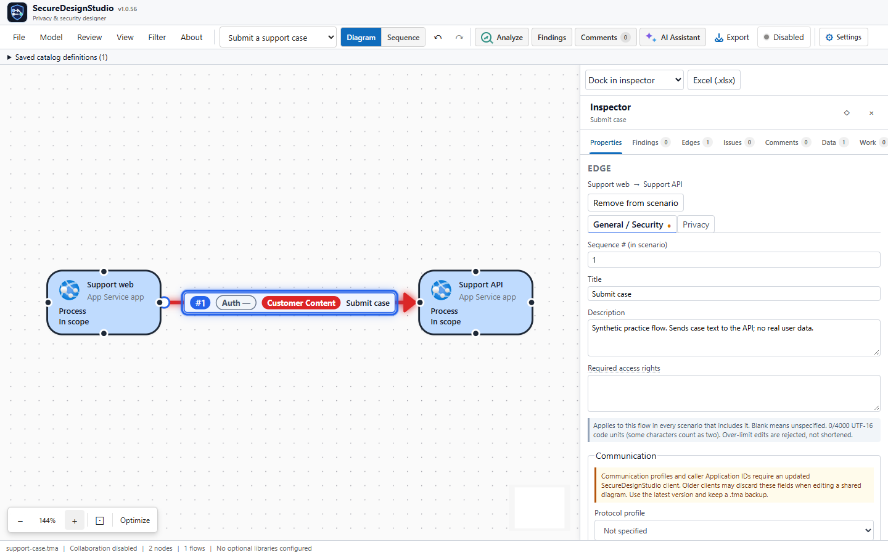

# SecureDesignStudio

**Spend less time preparing diagrams and more time improving designs.**

SecureDesignStudio is a local, browser-based workspace for security and privacy
reviews on **Windows, macOS, and Linux**. Draw service interactions, describe
authentication and data handling, and record review findings in one editable
model. No Azure account or AI service is needed for local modeling and analysis.



*A support-case starter in the public app. Blank security fields are
questions to review, not verified controls.*

## Get started

### 1. Install the prerequisites

- [Git](https://git-scm.com/downloads) to download the public repository.
- [Node.js 24 LTS](https://nodejs.org/en/download), including **npm**, to run it.
- A current **Browser**.

Use your organization's approved installation process. Reopen your terminal
after installing, then check `git --version`, `node --version`, and
`npm --version`. In Windows PowerShell, use `npm.cmd` instead of `npm` if its
script wrapper is blocked. See the [platform setup notes](docs/user-guide.md#from-source-on-windows-macos-or-linux)
for installation options and alternative launchers.

### 2. Download, start, and open

In a terminal, go to a folder where you keep projects, then run each line in order:

```sh
git clone https://github.com/microsoft/SecureDesignStudio.git
cd SecureDesignStudio
npm start
```

In a Shell, or Windows PowerShell, the last command can be **`npm.cmd start`**.
The launcher checks prerequisites and port 5173, installs missing or incompatible
direct dependencies, and starts the app. The first dependency installation needs
internet access and may take a few minutes; stop and read any reported error.

Open **<http://localhost:5173/>** in your browser yourself. Keep the terminal
open while working; **Ctrl+C** in that terminal stops your server.
For later sessions, return to the `SecureDesignStudio` folder and run `npm start`.

### 3. Explore a sample and save your first model

1. Download the sample [customer profile model](samples/customer-profile-service.tma)
   using GitHub's **Download raw file** button, or use the copy already in your
   cloned repository's `samples` folder.
2. In **Create your first scenario**, choose **Open model (.tma)...** and select
   that file. If a model is already open, save it first, then use **File > Open**.
3. Keep the first scenario selected. Select a node or arrow to inspect its
   **Properties** and **Privacy** details. Use **Fit model to view** to see the
   diagram; **Optimize** rearranges it and supports Undo.
4. Choose **Review > Analyze** for local model checks, then **Review > Findings**
   to explore retained findings and their STRIDE evidence. A zero count is not
   a security pass. **View > Sequence** shows the scenario's call order.
5. Choose **File > Save as > SecureDesignStudio model (.tma)** to save your own
   copy. Your browser may ask for a location or download the file to Downloads.
   Reopen it with **File > Open**.

**NOTE - Autosave is built in for recovery, not backup.** Save `.tma` files regularly and before
replacing, importing, or sharing a model. Keep real personal information and
secrets out of practice models, and review contents before sharing.

To draw from scratch, follow the [short manual walkthrough](docs/user-guide.md#build-a-model-manually).
More [synthetic samples](samples/README.md) cover payments, AI, healthcare,
and multi-tenant services.

## What you can do

- **Model a workflow:** nodes, directional flows, security/privacy boundaries,
  shared components, and scenarios with Diagram and Sequence views.
- **Record security and privacy together:** authentication, required access
  rights, request/response data, classifications, and retention.
- **Review and compare:** local Analyze checks, STRIDE-organized Findings,
  comments, work items, and **File > Compare to previous**.
- **Import and share:** TM7 and documented scenario/DFD JSON imports; PMEXP
  inventory merge; Visio, TM7, HTML report, and PNG exports.
  Keep `.tma` as the editable backup; exports have
  [format-specific limits](docs/user-guide.md#7-import-and-export).

Modeling and local analysis run in the browser. After dependency installation
and page load, editing, analysis, autosave, and local file operations work
offline while the app remains open. The app does not inspect live deployments
or certify security/privacy compliance.

## Optional AI and services

The **Design Assistant** is opt-in and separate from local **Analyze**. The Design Assistant will run your model thru a bring your own authorized Azure OpenAI/Foundry deployment, Claude Code, or
Codex CLI subscription model. This provides dynamic **AI analysis** and insight into possible risks. **Find Attack Path** will simulate a attack against the service based on known vulnerabilities. And **Chat** allows you to discuss security/privacy/compliance issues associated with your designs setup, data handling. Detailed set up and use are
covered in [Bring your own AI](docs/bring-your-own-ai.md).

Normal `npm start` enables **neither AI nor collaboration**. Collaboration
requires an explicitly configured deployed/standalone build. Custom Libraries
add modeling definitions, not service access. See
[advanced configuration](docs/advanced-configuration.md).

## If setup gets stuck

| Problem | Next step |
|---|---|
| `git`, `node`, or `npm` is not found | Reopen the terminal after installation; check PATH and that Node.js includes npm. |
| Node is too old | Select Node.js 24 LTS, reopen the terminal, and check `node --version`. |
| PowerShell blocks `npm.ps1` or a `.ps1` launcher | Use `npm.cmd start`; do not weaken execution policy. |
| Port 5173 is occupied | Stop only your own previous server with Ctrl+C. Otherwise coordinate with its owner; do not kill an unfamiliar process or change ports. |
| Browser cannot connect | Keep the terminal open, check startup errors, and use exactly `http://localhost:5173/`. |
| Dependency installation fails | Check approved internet/proxy/package access and the terminal error. Resolve the cause, then retry `npm ci` (`npm.cmd ci` in PowerShell). Do not bypass network or certificate controls. |

For updates, save a `.tma` backup and follow the
[safe update steps](docs/user-guide.md#update-an-existing-clone-safely), including
`npm ci` after lockfile changes.

## Guides and contributing

- [User guide](docs/user-guide.md), [use cases](docs/use-cases.md), and [sample models](samples/README.md)
- [Authentication](docs/authentication-library.md), [classification](docs/classification-library.md),
  [Custom Libraries](docs/custom-libraries.md), and [cloud node catalog](docs/microsoft-cloud-node-catalog.md)
- [Saved-model compatibility](docs/model-compatibility.md), [catalog snapshots](docs/catalog-snapshots.md),
  and [TM7 compatibility](docs/tm7-compatibility.md)
- [Architecture](docs/architecture.md), [tool threat model](docs/tool-threat-model.md),
  [release verification](docs/release-verification.md), and [changelog](CHANGELOG.md)
- [Contributing and validation](docs/contributing.md) and [browser test guide](tests/browser/README.md)

Builds and tests are contributor tasks, not first-run requirements.
Contributions and synthetic examples are welcome. Report vulnerabilities through
the [security policy](https://github.com/microsoft/SecureDesignStudio/security/policy).

Project-authored public source is licensed under [MIT](LICENSE), copyright
Microsoft Corporation. Third-party code and Microsoft product icons retain their
own terms; see [third-party notices](docs/third-party-notices.md).
The project license does not relicense those components or grant trademark rights.
