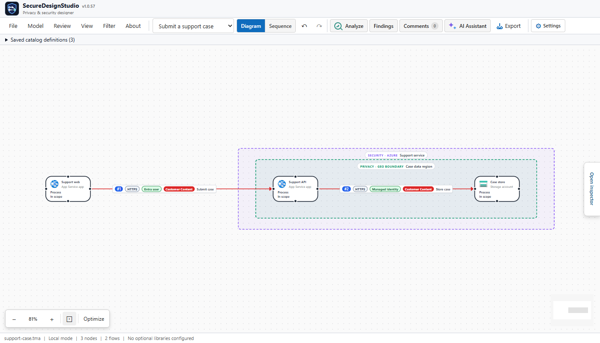

# SecureDesignStudio

**Spend less time preparing diagrams and more time improving designs.**

SecureDesignStudio is a local, browser-based workspace for security and privacy
reviews on **Windows, macOS, and Linux**. Draw service interactions, describe
authentication and data handling, and record review findings in one editable
model. No Azure account or AI service is needed for local modeling and analysis.

*The support-case walkthrough. The diagram records sample assumptions, not
verified deployed controls.*

## Start here

**First time using SecureDesignStudio? Go to the [user guide](docs/user-guide.md).**
It is the single step-by-step guide for setup and your first model:

1. [Set up and start the app](docs/user-guide.md#2-how-to-install-and-run).
   Use Git, Node.js 24 LTS with npm, and a modern browser such as Firefox,
   Microsoft Edge, or Google Chrome on Windows, macOS, or Linux.
2. [Build the support-case sample](docs/user-guide.md#3-start-the-support-case-walkthrough).
   Start manually; no cloud account or AI provider is required.
3. Continue through [Sequence](docs/user-guide.md#4-walk-through-the-calls-in-sequence)
   and [review and export](docs/user-guide.md#5-review-the-support-case-design)
   in the same guide.

There is no separate setup guide to complete first. Setup instructions live
in the user guide so you do not have to compare competing commands.
Save `.tma` backups and keep real personal information and secrets out of
practice models.

After the walkthrough, follow the [documentation reading order](#reading-and-review-order).
[More samples](samples/README.md) cover payments, AI, healthcare, and
multi-tenant services.

## What you can do

- **Model a workflow:** nodes, directional flows, security/privacy boundaries,
  shared components, and scenarios with Diagram and Sequence views.
- **Record security and privacy together:** authentication, required access
  rights, request/response data, classifications, and retention.
- **Review and compare:** local Analyze checks, STRIDE-organized Findings,
  comments, work items, and **File > Compare to previous**.
- **Import and share:** TM7 and documented scenario/DFD JSON imports; PMEXP
  inventory merge; Visio, TM7, HTML report, and PNG exports.
  Keep `.tma` as the editable backup; exports have
  [format-specific limits](docs/advanced-configuration.md#import-and-export).

Modeling and local analysis run in the browser. After dependency installation
and page load, editing, analysis, autosave, and local file operations work
offline while the app remains open. The app does not inspect live deployments
or certify security/privacy compliance.

## Optional AI and services

The **Design Assistant** is opt-in and separate from local **Analyze**.
Bring an authorized Azure OpenAI/Foundry deployment, Claude Code, or Codex CLI
subscription. AI can propose a design, discuss it in Chat, and suggest review
findings. **Simulate breach** illustrates a path using retained AI findings and
connected flows; it does not execute an attack or verify a vulnerability.
Complete the manual walkthrough first. For optional provider setup, use
[Bring your own AI](docs/bring-your-own-ai.md).

Normal `npm start` enables **neither AI nor collaboration**. Collaboration
requires an explicitly configured deployed/standalone build. Custom Libraries
add modeling definitions, not service access. See
[advanced configuration](docs/advanced-configuration.md).

For setup problems, use [troubleshooting](docs/advanced-configuration.md#troubleshooting-and-quick-reference).
For updates, save a `.tma` backup and follow the
[safe update steps](docs/user-guide.md#update-an-existing-clone-safely), including
`npm ci` after lockfile changes.

## Documentation and contributing

### Reading and review order

Review the documentation in this order. Beginners only need steps 1-3 to
set up, build, review, and save their first model.

| Order | Document | What to review |
|---|---|---|
| 1 | This README | What the app does and where a first-time user starts. |
| 2 | [User guide: concepts and setup](docs/user-guide.md#1-what-securedesignstudio-is) | Learn the terms, then install and run the app in section 2. This is the only beginner setup guide. |
| 3 | [User guide: support-case walkthrough](docs/user-guide.md#3-start-the-support-case-walkthrough) | Build manually, follow Sequence, review, and export. Skip the optional AI exercises initially. |
| 4 | [Sample models](samples/README.md) | Explore other designs after completing the walkthrough. |
| 5 | [Advanced configuration and reference](docs/advanced-configuration.md) | Customize modeling and review settings; consult import/export and troubleshooting only when needed. |
| 6 | [Bring your own AI](docs/bring-your-own-ai.md) | Optional provider setup. It is not a prerequisite for manual modeling or Analyze. |
| 7 | [Use cases](docs/use-cases.md) → [Architecture and design](docs/architecture.md) | Move from user workflows to components, data ownership, persistence, and optional services. |
| 8 | [Contributing and validation](docs/contributing.md) | Read before changing code or preparing a release, not before using the app. |

Focused references are optional branches from that path:

| Need | Reference |
|---|---|
| Choose or customize definitions | [Authentication](docs/authentication-library.md), [classification](docs/classification-library.md), [cloud node catalog](docs/microsoft-cloud-node-catalog.md), [Custom Libraries](docs/custom-libraries.md) |
| Exchange or reopen models | [Saved-model compatibility](docs/model-compatibility.md), [catalog snapshots](docs/catalog-snapshots.md), [TM7 compatibility](docs/tm7-compatibility.md) |
| Understand authored review records | [Threat notes](docs/threat-notes.md) |
| Assess the app or verify a download | [Tool threat model](docs/tool-threat-model.md), [release verification](docs/release-verification.md), [third-party notices](docs/third-party-notices.md) |

For code changes, use [contributing and validation](docs/contributing.md)
and the [browser test guide](tests/browser/README.md).

Builds and tests are contributor tasks, not first-run requirements.
Contributions and sample models are welcome. Report vulnerabilities through
the [security policy](https://github.com/microsoft/SecureDesignStudio/security/policy).

Project-authored public source is licensed under [MIT](LICENSE), copyright
Microsoft Corporation. Third-party code and Microsoft product icons retain their
own terms; see [third-party notices](docs/third-party-notices.md).
The project license does not relicense those components or grant trademark rights.
