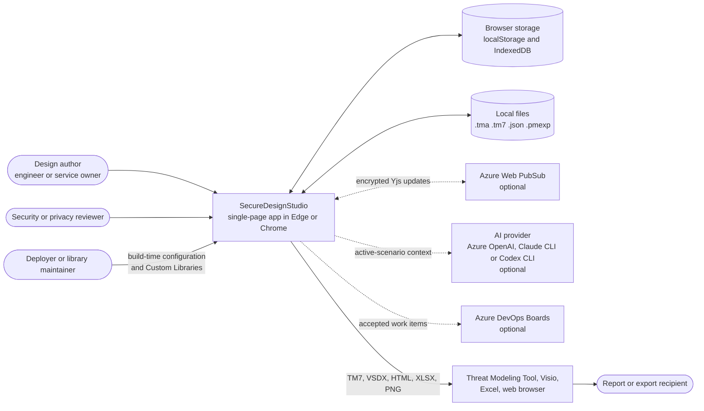
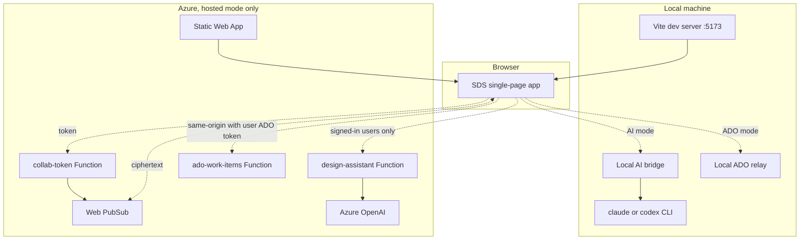
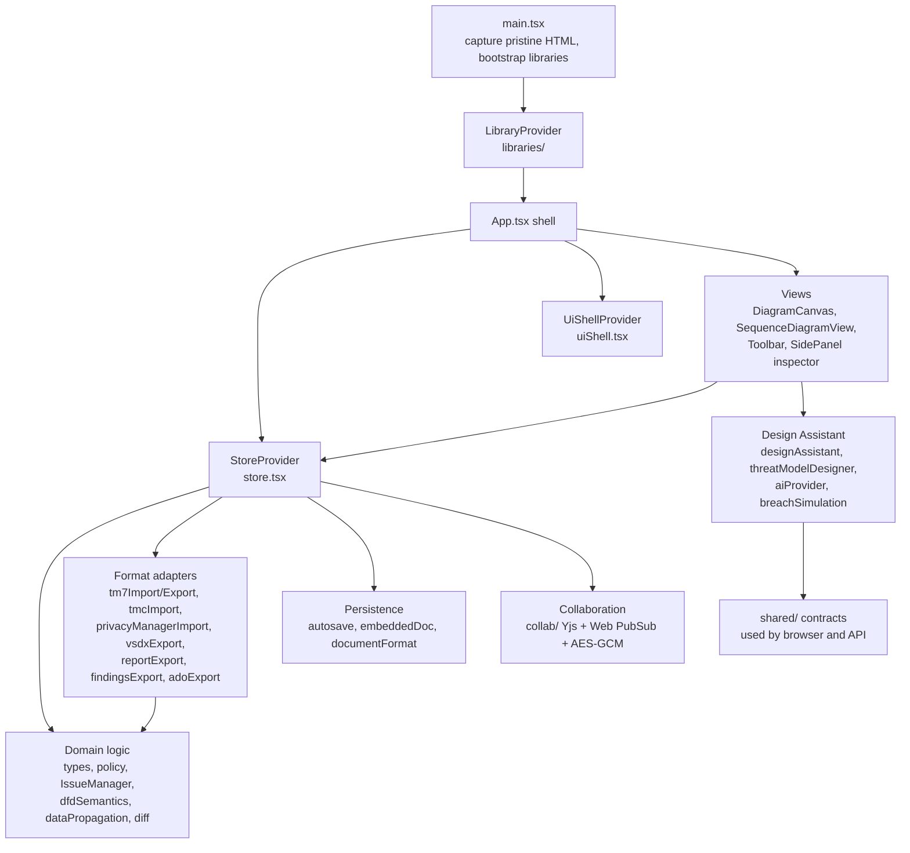
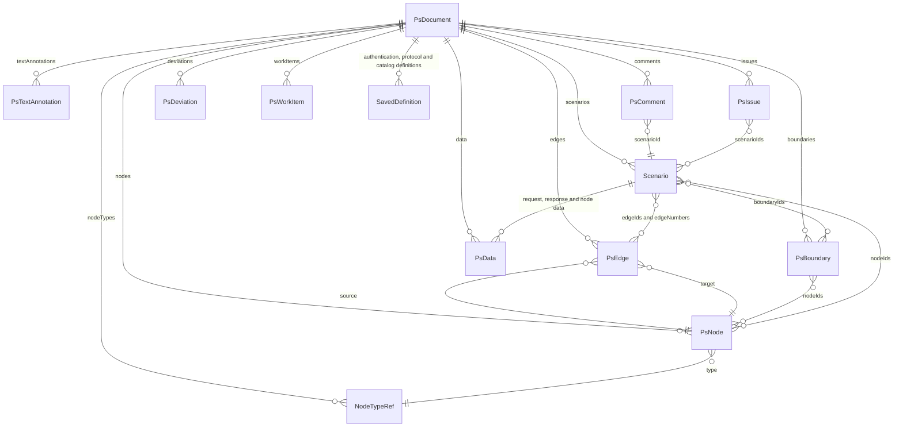
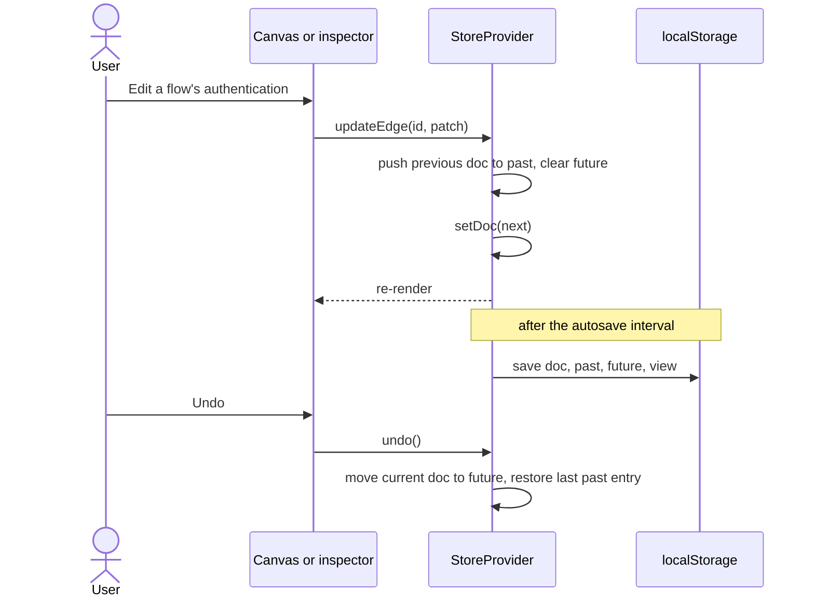
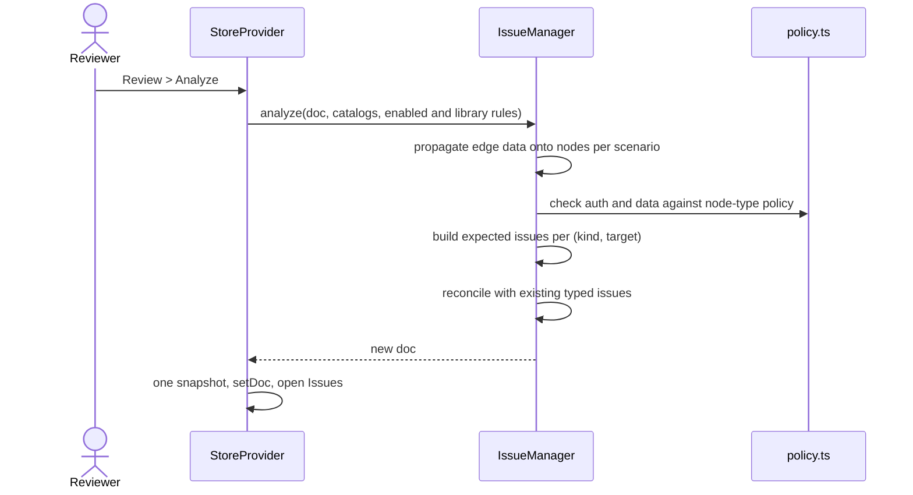
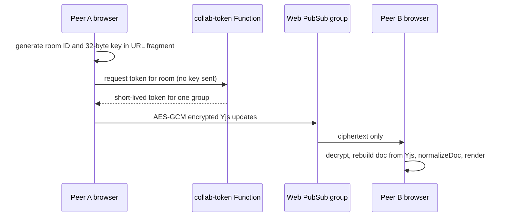
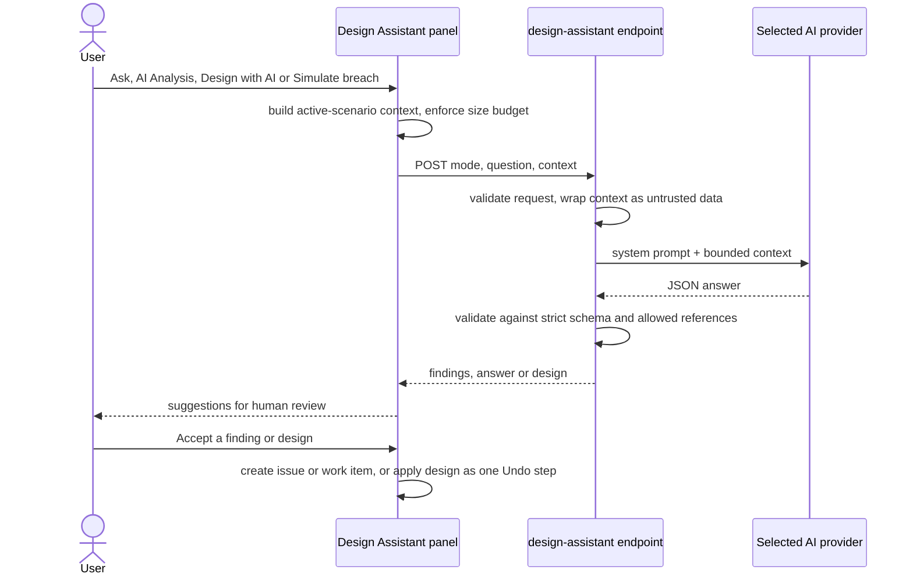

# SecureDesignStudio architecture and design

*Updated: 2026-11-04 - First version: system context, runtime modes, components, data model, key flows and design decisions.*

This page explains how SecureDesignStudio (SDS) is built. It is meant for
contributors, maintainers, deployers and reviewers who need to understand the
application before changing, hosting or assessing it. For what people do with
the app, see [use cases](use-cases.md). For step-by-step instructions, see the
[user guide](user-guide.md).

This is a design description, not a feature contract. When this page and a
feature contract (for example the [Authentication Library](authentication-library.md)
or [Custom Libraries](custom-libraries.md)) disagree, the contract and the
source are authoritative. Report vulnerabilities through
[SECURITY.md](../SECURITY.md), not through issues.

The structure follows common architecture-description practice: context,
containers, components, data, runtime behavior, cross-cutting concepts and
recorded decisions (similar to the C4 model and arc42). The diagrams use
Mermaid, which GitHub renders in place.

## 1. Goals and constraints

| Goal or constraint | What it means for the design |
|---|---|
| **Local first** | Modeling, analysis, autosave and file operations run entirely in the browser. Normal local mode has no application backend and needs no cloud credentials. |
| **Offline after first load** | Once dependencies are installed and the page has loaded, editing, Analyze, autosave and local files keep working without a network. |
| **Opt-in services that fail closed** | Collaboration, the Design Assistant and Azure DevOps (ADO) submission are off unless a build or launcher explicitly configures them. Invalid configuration disables the service instead of falling back to a default. |
| **Durable, portable models** | The native `.tma` file is the editable source of truth. Saved definitions travel with the model so it reopens with the same meaning on another machine or build. |
| **Backward compatibility** | Older native files, legacy format names and unfamiliar catalog identifiers remain readable. Stable IDs are never regenerated on open or save. |
| **One-step Undo** | Every user-visible operation, including bulk imports and AI-applied designs, is a single undoable step. |
| **Bounded claims** | The app records design intent and review decisions. It does not inspect deployments, enforce boundaries or certify security or privacy compliance. User-facing text avoids implying otherwise. |

## 2. System context

Dotted arrows are optional integrations. None is contacted in normal local
mode.

## 3. Runtime modes (containers)

SDS is a React single-page app built with Vite. The same source produces
several runtime shapes. The mode is decided at **build or launch time** through
Vite `define` constants in [`vite.config.ts`](../vite.config.ts); a model file,
profile preference or URL cannot change it.

| Mode | Started by | Backend pieces | Services available |
|---|---|---|---|
| Local | `npm run dev` or `Start-SecureDesignStudio.ps1` | Vite dev server on `http://localhost:5173` only (`strictPort`) | None |
| Local AI | `npm run dev:ai` or `Start-SecureDesignStudio-WithAI.ps1` | Vite plus a local `/api/design-assistant` bridge ([`scripts/local-ai-vite.mjs`](../scripts/local-ai-vite.mjs)). Azure uses the Functions host; Claude and Codex use their CLIs through [`localProviders.ts`](../api/design-assistant/localProviders.ts) | Design Assistant only |
| Local ADO | `npm run dev:ado` | Vite plus a localhost ADO relay ([`scripts/local-ado-vite.mjs`](../scripts/local-ado-vite.mjs)) | ADO submission only |
| Hosted | `npm run build` (`dist/`) deployed as an Azure Static Web App with [`api/`](../api) Functions | `collab-token`, `design-assistant`, `ado-work-items` Functions | Whatever the selected service configuration enables |
| Standalone | `npm run build` (`dist-single/index.html`) | None; one self-contained HTML file, which can also embed a model | Collaboration only if a hosted app URL and token endpoint were configured at build time |

Service resolution lives in [`src/serviceConfiguration.ts`](../src/serviceConfiguration.ts)
and [`src/services.ts`](../src/services.ts). Local serving refuses endpoint
overrides outright. Builds read an explicit service file or environment
variables through [`scripts/service-configuration.mjs`](../scripts/service-configuration.mjs),
which also writes a `service-build.json` receipt. **About** shows the
effective configuration. The [advanced configuration](advanced-configuration.md)
page documents each variable.

## 4. Components

| Layer | Responsibility | Main sources |
|---|---|---|
| Bootstrap | Captures the parsed HTML for standalone export before React mounts, loads build-selected Custom Libraries, mounts the app in `StrictMode`. | [`main.tsx`](../src/main.tsx), [`libraries/bootstrap.ts`](../src/libraries/bootstrap.ts) |
| Shell and UI state | Layout, theme, inspector placement, autosave interval and other per-browser presentation settings. | [`App.tsx`](../src/App.tsx), [`uiShell.tsx`](../src/uiShell.tsx) |
| Store | The only owner of the working document, selection, filters, active scenario, Undo/Redo history, profile libraries, collaboration session and every mutating operation. | [`store.tsx`](../src/store.tsx) |
| Views | React components that read from the store and call its operations. Graph editing uses `@xyflow/react`; the sequence view renders the same scenario as a call timeline. Switching views never changes the document. | [`components/`](../src/components) |
| Domain logic | Pure functions and classes: model types and catalog lookups, node policy, deterministic analysis, DFD role and scope resolution, data propagation and semantic diff. | [`types.ts`](../src/types.ts), [`policy.ts`](../src/policy.ts), [`IssueManager.ts`](../src/IssueManager.ts), [`dfdSemantics.ts`](../src/dfdSemantics.ts), [`dataPropagation.ts`](../src/dataPropagation.ts), [`diff.ts`](../src/diff.ts) |
| Libraries and catalogs | Shipped JSON catalogs plus profile-editable Authentication, Classification and Communication libraries, and build-selected Custom Libraries. | [`src/data/`](../src/data), [`authentication.ts`](../src/authentication.ts), [`classificationLibrary.ts`](../src/classificationLibrary.ts), [`protocols.ts`](../src/protocols.ts), [`libraries/`](../src/libraries) |
| Format adapters | Convert between the native model and external formats. Each adapter documents what it maps and what it drops. | See [section 8](#8-import-and-export-adapters) |
| Persistence | Browser autosave, native file wrapper, and standalone HTML self-embedding. | [`autosave.ts`](../src/autosave.ts), [`documentFormat.ts`](../src/documentFormat.ts), [`embeddedDoc.ts`](../src/embeddedDoc.ts) |
| Collaboration | Mirrors the document into a Yjs document, encrypts updates with a room key, and relays them through Web PubSub. | [`collab/`](../src/collab), [`api/collab-token`](../api/collab-token) |
| Design Assistant | Builds a bounded, scenario-scoped request; validates responses against strict schemas; applies AI designs as one undoable change; animates an attack path built from connected flows near the top AI finding. | [`designAssistant.ts`](../src/designAssistant.ts), [`threatModelDesigner.ts`](../src/threatModelDesigner.ts), [`breachSimulation.tsx`](../src/breachSimulation.tsx), [`api/design-assistant`](../api/design-assistant), [`shared/`](../shared) |
| Work submission | Local work-item queue, CSV and Excel templates, and explicit ADO submission with a durable browser journal that prevents duplicate creation. | [`workItems.ts`](../src/workItems.ts), [`workSubmission.ts`](../src/workSubmission.ts), [`adoClient.ts`](../src/adoClient.ts), [`adoExport.ts`](../src/adoExport.ts), [`shared/adoContract.ts`](../shared/adoContract.ts), [`api/ado-work-items`](../api/ado-work-items) |

## 5. Data model

The whole model is one serializable `PsDocument` ([`src/types.ts`](../src/types.ts)).
Nodes, flows (edges) and boundaries are **shared**: there is one copy of each,
and scenarios reference them. Everything that differs per workflow lives on
the scenario.

| Entity | Scope | Key design points |
|---|---|---|
| `PsNode` | Shared | A service, process, data store or external dependency. Its `type` references a node-type definition that supplies policy (allowed authentication and data), icon, default DFD role and privacy defaults. Instance values can override deferred type values. |
| `PsEdge` | Shared | A directed source-to-target call. Holds authentication method, caller Application ID, audience, communication profile, required access rights and waypoints. Missing values mean *unspecified*, never *none*. |
| `PsBoundary` | Shared | A security or privacy rectangle with a subtype and optional network-intent notes. Membership is the `nodeIds` it contains; boundaries can overlap. Boundaries describe intent and do not enforce isolation. |
| `Scenario` | Per workflow | Membership lists, call order (`edgeIds` and `edgeNumbers`), DFD scope reasons, and data attachments. Request data is checked against the target's policy; response data against the source's. |
| `PsData` | Shared catalog | A reusable data item with a classification and an optional synthetic sample. |
| `PsComment` | One scenario | Discussion on a node or edge in one scenario, with replies and Active or Resolved status. |
| `PsIssue` | Several scenarios | A finding on a node or edge. Analyzer issues carry a rule `kind`; manual issues and authored threat notes do not, so Analyze never touches them. |
| `PsDeviation` | Document | An evidence-backed exception with a stable `key` so repeated evidence reviews update rather than duplicate it. |
| `PsWorkItem` | Document | A follow-up record with a review decision, classification and optional external submission receipt. |
| Saved definitions | Document | Copies of the authentication, communication-profile and catalog definitions the model references, so meaning survives on builds or profiles that lack them. |

The native `.tma` file wraps the document as
`{ format: "secure-design-studio-diagram", version: 2, doc, view }`, where
`view` holds the active scenario and filter. The legacy `privsec-diagram`
format name is still accepted. See [model compatibility](model-compatibility.md)
and [catalog snapshots](catalog-snapshots.md) for the identifier and
saved-definition rules.

## 6. State, history and persistence

- **Single store.** `StoreProvider` owns the document in React state and
  exposes typed operations (`createNode`, `attachDataToEdge`, `analyze`,
  `importJson` and so on). Components never mutate the document directly.
- **Snapshot-based Undo.** A mutating operation records the previous full
  document before it changes anything. Compound operations (imports, scenario
  deletion, AI-applied designs, Analyze) compute the new document first and
  apply it once, so they are one Undo step. History holds up to 100 entries.
- **One normalization gate.** Every document from outside the store (native
  open, JSON import, autosave recovery, embedded standalone HTML and
  collaboration peers) passes through `normalizeDoc` in
  [`store.tsx`](../src/store.tsx). It validates shapes, keeps unfamiliar but
  valid identifiers, and rejects or repairs malformed values without
  regenerating stable IDs.
- **Autosave.** The document, Undo/Redo stacks and view are written to
  `localStorage` (`secure-design-studio:autosave:v1`) on a debounce the user
  can set (0.5 to 15 seconds). On quota errors, saving retries with shorter
  history (25, 10, 5, then 0 entries). Autosave is recovery, not a backup.
- **Profile libraries.** Authentication, Classification and Communication
  libraries, the AI provider choice and ADO configuration are per-browser
  profile settings in separate `localStorage` keys. They supply authoring
  choices and never silently rewrite an open model.
- **Native files.** Save uses the browser's file-save picker where available
  and falls back to a download.

## 7. Key runtime flows

### Edit, Undo and autosave

### Analyze

### Collaboration

### Design Assistant request

## 8. Import and export adapters

| Adapter | Direction | Notes |
|---|---|---|
| Native `.tma` and node catalog JSON | Open, save | Lossless editable source of truth. |
| Microsoft Threat Modeling Tool `.tm7` | Import, export | Each TMT tab maps to a scenario. Elements are deduplicated by TMT GUID. XML with a `DOCTYPE` or entity declaration is rejected before parsing. Lossy; see [TM7 compatibility](tm7-compatibility.md). |
| Scenario/DFD JSON (`scenarios`, `dfds`) | Import, replaces the model | IDs derive from source GUIDs so reimports stay stable. [`tmcImport.ts`](../src/tmcImport.ts). |
| Privacy Manager inventory `.pmexp` | Import, merges into an existing scenario | Map, create or ignore each inventory service; one Undo step. [`privacyManagerImport.ts`](../src/privacyManagerImport.ts). |
| Endpoint text | Import nodes | **Nodes from endpoints** matches URLs or request lines against node-type endpoint patterns. |
| Visio `.vsdx` | Export only | One page per scenario, built on an embedded BSD-3 template; see [third-party notices](third-party-notices.md). Not a Visio importer. |
| HTML review report | Export only | Escaped text, allow-listed links and a restrictive content security policy. |
| PNG diagram image | Export only | The current scenario's diagram. |
| Excel `.xlsx` workbook and ADO CSV | Export only | Text-only cells, no formulas or macros; long text split instead of truncated. |
| Standalone HTML | Export, open | The single-file app with the model embedded as escaped JSON. Open only trusted files, because opening one runs its code. |

## 9. Analysis engine

[`IssueManager`](../src/IssueManager.ts) is deterministic and local. It never
runs code from a model. Its rules are registered in `ANALYZER_RULES`:

| Rule | Finding kinds |
|---|---|
| Edge must carry data | `Edge_must_have_data` |
| Node retention recorded | `Node_retention_missing` |
| Single authentication method per flow | `Edge_multiple_auth_methods` |
| Authentication definition review | `Edge_authentication_definition_review` |
| Receiver accepts the authentication | `Edge_auth_not_accepted` |
| Receiver accepts the data | `Edge_data_not_accepted`, `Node_data_not_accepted` |
| Deferred instance values supplied | `Node_missing_deferred_geo`, `Node_missing_deferred_retention` |
| Caller identity | `Edge_missing_application_id`, `Edge_invalid_application_id`, `Edge_managed_identity_mismatch` |
| Communication profile guidance | `Edge_protocol_guidance_missing`, `Edge_protocol_definition_conflict` |

Custom Libraries can add declarative `required` or `guid` checks on their own
metadata fields; they cannot add code.

Reconciliation is what makes repeated reviews workable:

- A finding is identified by `(kind, targetKind, targetId)`. When it still
  triggers, its ID, status, replies and creation time are kept; title,
  description and scenarios are refreshed.
- A typed finding is removed only after its rule has **completely** evaluated
  the target, or when the target no longer exists.
- If a rule or required policy definition is unavailable, the finding is kept
  whole and labeled **Not re-evaluated**. It is not silently cleared.
- Untyped issues (manual issues and authored threat notes) are never changed.

AI Analysis is separate. It returns suggested findings with severities that
stay suggestions until a person creates an issue or work item from them.

## 10. Extensibility

| Mechanism | Who selects it | Where it lives | What it can change |
|---|---|---|---|
| Shipped catalogs | Source | [`src/data/`](../src/data) | Default node types, authentication methods, classifications, boundaries, protocols. |
| Profile libraries | Each user, per browser profile | `localStorage` | Authoring choices for authentication, classification and communication profiles. They never install services or rewrite models. |
| Node-type catalog | Model author | The document | Document-local node types; import and export as JSON. |
| Custom Libraries | Deployer, at build or dev-server start (`SDS_LIBRARY_PATHS`) | Declarative JSON packages | Catalog entries, metadata fields, declarative checks and help. At most 16 packages, 1 MiB each, 4 MiB total. A model, profile, room or URL cannot select a package, and packages cannot enable services or grant access. |

See [Custom Libraries](custom-libraries.md) for the package contract.

## 11. Cross-cutting concepts

- **All input is untrusted.** Model text renders as text. Links render only
  for `http`, `https` and `mailto` ([`urlSafety.ts`](../src/urlSafety.ts)).
  AI prompts mark model content as data, not instructions, and AI responses
  are schema-validated and may reference only elements that exist.
- **Unspecified is not negative.** A missing protocol, authentication method
  or retention value means *not recorded*. Neither the UI nor Analyze treats
  it as evidence of cleartext, no authentication or no storage.
- **Saved meaning wins over current catalogs.** When a model carries a saved
  definition, labels and semantics come from it first. Choosing a new value
  explicitly is undoable; viewing or saving never resolves it implicitly.
- **Hosted request checks.** The hosted Design Assistant route admits only
  signed-in Static Web App users and calls Azure OpenAI through
  `DefaultAzureCredential`, so no model key reaches the browser. The ADO relay
  requires a same-origin HTTPS request carrying the user's own ADO bearer
  token. The collaboration token route is anonymous and issues 60-minute
  tokens scoped to one room ([`staticwebapp.config.json`](../staticwebapp.config.json)).
- **Explicit external effects.** Nothing contacts a service implicitly. Joining
  a room, sending an AI request and submitting to ADO are separate user
  actions, and Undo cannot reverse an external write.
- **Accessibility and layout.** Controls are keyboard reachable with visible
  focus, and automated checks cover 320 to 1366 CSS-pixel widths in light and
  dark themes. Human usability and screen-reader passes are separate,
  manual gates.
- **Provenance.** Runtime dependency licenses, the Visio template notice and
  icon terms are tracked and shown under **About**.

## 12. Key design decisions

| Decision | Rationale | Consequences |
|---|---|---|
| Browser-only app with no required backend | Reviews often involve sensitive designs; local use needs no account, tenant or data egress. | All logic is client-side. Optional services are added at the edges and stay off by default. |
| Shared entities with per-scenario membership | A service appears in many workflows; renaming it once must update all of them. | Call order, data attachments, retention and comments live on scenarios. Deleting a scenario must not delete shared members still used elsewhere. |
| Full-document snapshots for Undo | Simple, correct one-step Undo for any compound change, including imports and AI designs. | Memory and autosave size grow with model size. History is capped at 100 entries, and persisted history is trimmed on quota errors. |
| One `normalizeDoc` gate for every inbound document | Files, autosave and collaboration peers are equally untrusted, so one gate keeps their validation identical. | New fields must be added to normalization, or they are dropped or rejected on load. |
| Rule-keyed finding reconciliation | Reviewer status and replies must survive repeated Analyze runs. | Rule `kind` strings are a compatibility contract. Renaming one requires retirement handling, as done for the legacy production-identity kinds. |
| Saved definitions travel with the model | Models move between people, profiles and builds with different libraries. | Files are larger. Conflicts between saved and installed definitions are shown to the user, not auto-resolved. |
| Build-time service selection that fails closed | A model, link or preference must not be able to redirect data to a service. | Changing services requires a rebuild or relaunch. Invalid configuration disables the feature. |
| End-to-end encrypted collaboration with the key in the URL fragment | The relay should see only ciphertext. Browsers do not send fragments to servers. | Anyone with the link can read and edit. Peers are equal and edits are not attributed. |
| Repository-owned single-file inliner | Avoids a plugin dependency chain with unpatched transitive packages. | The project maintains [`scripts/single-file-build.mjs`](../scripts/single-file-build.mjs) and its tests. |

## 13. Quality and testing

Tests use Node's built-in test runner. Pure contracts live in
[`tests/authentication/`](../tests/authentication) (`npm run test:runtime`).
Browser suites drive an installed Edge or Chrome with `playwright-core`
against an owned Vite server, synthetic `.tma` fixtures and a network policy
that blocks all non-local traffic ([`tests/browser/README.md`](../tests/browser/README.md)).
[Contributing](contributing.md) maps each kind of change to the suites it
requires.

## 14. Known limits and maintenance hotspots

- `store.tsx` (about 5,500 lines) and `components/Toolbar.tsx` (about 3,300
  lines) hold most operations and commands. Changes there have a wide blast
  radius; keep the matching browser suites close.
- Older builds can drop newer metadata when they write to a shared model or
  room. Use matching current builds for every collaboration peer and keep an
  editable `.tma` backup.
- External exports are lossy drawings or reports, not round-trip formats.
- The tool documents design intent. It does not discover services, inspect
  live configuration or replace a threat model of SDS itself.

## Related documentation

- [Use cases](use-cases.md) and the [user guide](user-guide.md)
- [Advanced configuration](advanced-configuration.md), including the source map
- [Custom Libraries](custom-libraries.md), [Authentication Library](authentication-library.md)
  and [Classification Library](classification-library.md)
- [Model compatibility](model-compatibility.md), [catalog snapshots](catalog-snapshots.md)
  and [TM7 compatibility](tm7-compatibility.md)
- [Contributing](contributing.md) and the [browser test guide](../tests/browser/README.md)
