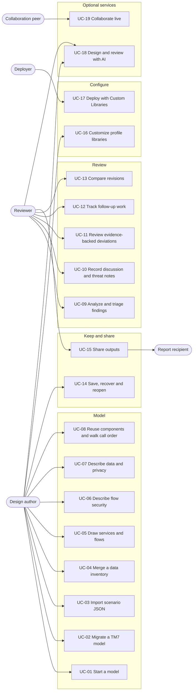

# SecureDesignStudio use cases

*Updated: 2026-11-04 - First version: actors, use-case catalog, detailed use cases and traceability.*

This page describes who uses SecureDesignStudio (SDS) and what they use it
for. It is meant for new users deciding whether SDS fits their review process,
contributors who need to know which workflows a change affects, and
maintainers planning features. For how the app is built, see
[architecture and design](architecture.md). For exact menu steps, see the
[user guide](user-guide.md).

Each use case is written in a lightweight structured format (goal, actors,
preconditions, main flow, alternatives, outcome). Each one also states what
the use case does **not** establish, because SDS records design intent and
review decisions; it does not verify deployed systems.

## 1. Actors

| Actor | Who they are | What they need from SDS |
|---|---|---|
| **Design author** | An engineer or service owner describing a system | Describe services, flows, data and boundaries quickly, reuse what already exists, and get early feedback before a formal review. |
| **Security or privacy reviewer** | The person assessing the design | See the same model as the author, find missing or inconsistent information, record findings and decisions, and compare revisions. |
| **Report recipient** | A stakeholder who receives an output but may not run SDS | Read a diagram, report or work list in a familiar format. |
| **Collaboration peer** | Another author or reviewer editing the same model live | Edit concurrently without overwriting each other. Needs a hosted, collaboration-enabled build. |
| **Deployer or library maintainer** | A team that builds and hosts SDS for an organization | Add organization-specific catalogs, metadata and checks; choose which optional services exist. |

| Secondary system | Role |
|---|---|
| Browser storage | Autosave recovery and per-profile libraries. |
| Microsoft Threat Modeling Tool, Visio, Excel | Sources or destinations of interchange files. |
| AI provider (Azure OpenAI, Claude CLI or Codex CLI) | Optional suggestions for design and review. |
| Azure Web PubSub | Optional encrypted relay for live collaboration. |
| Azure DevOps Boards | Optional destination for accepted work items. |

## 2. Use-case overview

| ID | Use case | Primary actor | Where in the app |
|---|---|---|---|
| UC-01 | Start a new model and first scenario | Author | First-run prompt, **Model > New scenario** |
| UC-02 | Migrate an existing Threat Modeling Tool model | Author | **File > Import > From TM7** |
| UC-03 | Import a scenario/DFD JSON model | Author | **File > Import > Import JSON format** |
| UC-04 | Merge a data inventory (PMEXP) | Author | **File > Import > PMEXP import** |
| UC-05 | Draw services, flows and boundaries | Author | Canvas context menu, **Nodes from endpoints** |
| UC-06 | Describe how each flow is secured | Author | Inspector **Properties** for a flow |
| UC-07 | Describe data, classification and retention | Author | **Model > Data Elements**, flow and node **Privacy** |
| UC-08 | Reuse components across scenarios and walk the call order | Author | Scenario membership, **View > Sequence** |
| UC-09 | Analyze the model and triage findings | Reviewer | **Review > Analyze**, **Review > Issues** |
| UC-10 | Record discussion and authored threat notes | Reviewer | **Review > Comments**, **Add threat note** |
| UC-11 | Review evidence-backed deviations | Reviewer | **Review > Deviations** |
| UC-12 | Track follow-up work and hand it to Azure DevOps | Reviewer | **Model > Work Items**, Work inspector tab |
| UC-13 | Compare the model with a previous revision | Reviewer | **File > Compare to previous**, **Review > Changes** |
| UC-14 | Save, recover and reopen a model | Author | **File > Save as**, autosave, **File > Open** |
| UC-15 | Share review outputs | Reviewer | **File > Save as** (TM7, Visio, standalone HTML, PNG, HTML report), Excel export |
| UC-16 | Customize authentication, classification and communication libraries | Author | **Model > Customize** commands |
| UC-17 | Deploy SDS with organization Custom Libraries | Deployer | Build configuration (`SDS_LIBRARY_PATHS`) |
| UC-18 | Design and review with AI (optional) | Author, reviewer | **File > Design with AI**, Design Assistant panel |
| UC-19 | Collaborate live on one model (optional) | Peers | Collaboration commands in a configured hosted build |

## 3. Detailed use cases

### UC-01 Start a new model and first scenario

- **Goal:** Begin describing a workflow from a blank model.
- **Preconditions:** SDS is open in Edge or Chrome. No account or AI setup is needed.
- **Main flow:**
  1. The author enters a scenario name such as *Submit a support case* in the first-run prompt and chooses **Create**.
  2. The author adds nodes from the canvas context menu and chooses a node type for each.
  3. The author connects nodes by dragging between handles to create flows.
  4. Changes autosave in the browser.
- **Alternatives:** A model is already open, so the author uses **Model > New scenario**. The author opens a [sample model](../samples/README.md) instead of starting blank.
- **Outcome:** A model with one scenario, its members and numbered flows.
- **Does not establish:** That the diagram matches the real deployment.

### UC-02 Migrate an existing Threat Modeling Tool model

- **Goal:** Reuse an existing `.tm7` model instead of redrawing it.
- **Preconditions:** A `.tm7` file from Microsoft Threat Modeling Tool.
- **Main flow:**
  1. The author imports the file.
  2. Each TMT tab becomes a scenario. Elements that appear on several tabs become one shared node or flow.
  3. The author fills in information TMT does not carry, such as data classifications and retention.
  4. The author saves a native `.tma`.
- **Alternatives:** The file contains a `DOCTYPE` or entity declaration and is rejected before parsing.
- **Outcome:** An editable SDS model that starts from the old diagram.
- **Does not establish:** A lossless round trip. See [TM7 compatibility](tm7-compatibility.md) for what is mapped and what is dropped.

### UC-03 Import a scenario/DFD JSON model

- **Goal:** Create a model from JSON in the documented `scenarios` and `dfds` structure.
- **Preconditions:** A JSON file in the supported format.
- **Main flow:**
  1. The author confirms that the import replaces the current model.
  2. SDS builds scenarios, nodes, boundaries and ordered flows, deriving IDs from the source GUIDs so a later reimport is stable.
  3. SDS summarizes any skipped records.
- **Alternatives:** The file is invalid, native or an inventory file; SDS rejects it without changing the model. The author cancels; nothing changes.
- **Outcome:** A replaced model, undoable in one step.
- **Does not establish:** That the source system's data was complete.

### UC-04 Merge a data inventory (PMEXP)

- **Goal:** Bring discovered data elements and retention into an existing model.
- **Preconditions:** A model with at least one scenario, and a local `.pmexp` export.
- **Main flow:**
  1. The author selects the file.
  2. For each inventory service, the author maps it to an existing node, creates a new node, or ignores it. Unique inventory matches are suggested.
  3. SDS merges data and retention into the mapped or created nodes.
- **Alternatives:** Ambiguous matches need an explicit decision. Repeated imports do not duplicate data.
- **Outcome:** Data and retention recorded on the nodes, undoable in one step. Source provenance is kept.
- **Does not establish:** That the inventory reflects current production. SDS calls no acquisition service.

### UC-05 Draw services, flows and boundaries

- **Goal:** Make a complex system easy to explain.
- **Preconditions:** An active scenario.
- **Main flow:**
  1. The author adds nodes and picks types from the cloud node catalog, which provides icons, a default DFD role and policy where defined.
  2. The author draws flows and adjusts their path with waypoints.
  3. The author draws security or privacy boundaries around nodes. Contained nodes join the boundary.
  4. The author adds free text annotations where helpful.
- **Alternatives:** The author pastes URLs or request lines into **Nodes from endpoints**, and SDS matches them to node types by endpoint pattern. Unmatched lines are offered as a separate download.
- **Outcome:** A data-flow diagram for the scenario.
- **Does not establish:** Boundaries do not enforce isolation; they record intended trust or custody.

### UC-06 Describe how each flow is secured

- **Goal:** Record authentication and access intent for every call.
- **Preconditions:** A flow exists.
- **Main flow:**
  1. The author selects the flow and opens **Properties**.
  2. The author chooses the single authentication method the call uses, the caller Application ID, the audience, a communication profile (for example HTTPS) and the required access rights.
  3. Canvas indicators show what is recorded.
- **Alternatives:** An older import has several methods on one flow; Analyze flags it until the author picks one. The method is not allowed by the receiving node type's policy; Analyze reports it.
- **Outcome:** Each flow carries its declared security properties.
- **Does not establish:** A declared protocol is not verified TLS. Authentication is not authorization. A missing value means *unspecified*, not *none*.

### UC-07 Describe data, classification and retention

- **Goal:** Keep privacy information next to the architecture.
- **Preconditions:** A scenario with flows.
- **Main flow:**
  1. The author defines data items in **Model > Data Elements**, each with a classification and an optional synthetic sample.
  2. The author attaches data to each flow, separately for the request and the response.
  3. The author records retention for data held by each receiving node in that scenario.
- **Alternatives:** A node type defers geography or post-subscription retention to the instance; the author supplies the instance value or Analyze reports it.
- **Outcome:** Directional data flows and retention per scenario.
- **Does not establish:** Receiving data does not prove it is stored. Classification labels are design metadata, not legal determinations.

### UC-08 Reuse components across scenarios and walk the call order

- **Goal:** Model several workflows that share services without duplicating them, and explain each workflow in order.
- **Preconditions:** At least one existing scenario.
- **Main flow:**
  1. The author creates another scenario, or clones one, and adds existing nodes and flows to it.
  2. The author sets the call order for that scenario, with custom numbers if needed.
  3. The author switches to **View > Sequence** to walk through the calls in order.
- **Alternatives:** The author deletes a scenario. SDS shows which members exist only in that scenario; shared members are kept.
- **Outcome:** Shared components with scenario-specific order, data and comments. Renaming a shared node updates every scenario.
- **Does not establish:** The sequence view shows declared order, not observed traffic.

### UC-09 Analyze the model and triage findings

- **Goal:** Focus review effort on missing information and inconsistencies.
- **Preconditions:** A model with at least one flow.
- **Main flow:**
  1. The reviewer chooses **Review > Analyze**. Local rules run across the whole document, not only the visible scenario.
  2. **Review > Issues** lists findings. The reviewer opens one to jump to its node or flow.
  3. The author corrects the model and the reviewer runs Analyze again. Still-triggered findings keep their status and replies; fixed ones are removed.
  4. The reviewer resolves findings they accept, or replies to discuss them.
- **Alternatives:** A rule or required definition is unavailable; the finding is kept and labeled **Not re-evaluated** rather than cleared. A Custom Library adds required-field or GUID checks.
- **Outcome:** A reconciled, reviewable list of findings.
- **Does not establish:** A clean Analyze run does not mean the design is secure or compliant. Resolution records a decision, not a fix.

### UC-10 Record discussion and authored threat notes

- **Goal:** Keep review conversation and identified threats with the model.
- **Preconditions:** A node or flow is selected.
- **Main flow:**
  1. The reviewer adds a comment, which belongs to the current scenario, and others reply.
  2. For a threat the reviewer wants to track, they choose **Add threat note** with an optional justification. It is stored as an issue that Analyze never alters.
  3. **Review > Comments** and **Review > Issues** show everything in one place.
- **Outcome:** Discussion and authored threats saved with the model.
- **Does not establish:** A threat note is a review concern, not an observed vulnerability.

### UC-11 Review evidence-backed deviations

- **Goal:** Review exceptions found when comparing the model with external service evidence.
- **Preconditions:** The model contains deviations, written by evidence tooling or present in an imported file.
- **Main flow:**
  1. The reviewer opens **Review > Deviations**.
  2. For network endpoint deviations, the reviewer opens **View sample calls** to see representative observed calls.
  3. The reviewer revises each deviation's required explanation.
- **Alternatives:** The deviation's target node or flow was removed; the deviation stays in the document.
- **Outcome:** Explained exceptions. Stable keys let repeated evidence reviews update the same record.
- **Does not establish:** The UI does not delete deviations or change their status. That stays with the evidence tooling.

### UC-12 Track follow-up work and hand it to Azure DevOps

- **Goal:** Turn review outcomes into tracked work without creating duplicates.
- **Preconditions:** Findings or review decisions to act on.
- **Main flow:**
  1. The reviewer creates a work item, by hand or with **Create work item** from an AI finding.
  2. The reviewer sets name, description, type (Bug or Task), severity and optional weakness type, then chooses **Accept**.
  3. The reviewer exports **ADO CSV** or the **ADO Excel template** for bulk import.
- **Alternatives:** In an ADO-enabled build, the reviewer signs in and explicitly submits accepted items. A durable browser journal and the item's Link prevent creating the same item twice.
- **Outcome:** A reviewed work list, exported or submitted.
- **Does not establish:** Export does not mean anything was created in ADO. Undo cannot reverse an external submission.

### UC-13 Compare the model with a previous revision

- **Goal:** See what changed between review rounds.
- **Preconditions:** A saved earlier `.tma` or compatible JSON.
- **Main flow:**
  1. The reviewer chooses **File > Compare to previous** and selects the baseline. The working model is not replaced.
  2. **Review > Changes** lists semantic differences by element. The reviewer selects a change to locate it.
- **Outcome:** A change list for focused re-review. **No changes** is a valid result.
- **Does not establish:** Position-only changes are ignored by design. This compares user models, not source code.

### UC-14 Save, recover and reopen a model

- **Goal:** Keep work safe and portable.
- **Main flow:**
  1. The author saves through **File > Save as > SecureDesignStudio model (.tma)**.
  2. Later, the author reopens it with **File > Open** on any machine. Saved definitions travel with the file, so labels and meaning are preserved.
- **Alternatives:** The browser tab closed unexpectedly; autosave restores the model and its Undo history on reload. The model references definitions this build does not have; they are kept and shown as unresolved.
- **Outcome:** A durable `.tma` file and browser recovery.
- **Does not establish:** Autosave is recovery, not backup. Clearing browser data removes it.

### UC-15 Share review outputs

- **Goal:** Give stakeholders the right artifact.
- **Main flow:**
  1. The reviewer chooses an output:
     - **TM7** for Threat Modeling Tool users.
     - **Visio** for diagram consumers.
     - **HTML review report** for readers without SDS.
     - **PNG** for slides and documents.
     - **Excel** for the complete review snapshot.
     - **Standalone HTML** for a self-contained app with the model embedded.
  2. The reviewer keeps the native `.tma` as the editable source.
- **Outcome:** An artifact suited to the recipient.
- **Does not establish:** Exports are lossy and are not round-trip formats. Recipients should open standalone HTML files only from trusted sources, because opening one runs its code. Review model contents before sharing.

### UC-16 Customize authentication, classification and communication libraries

- **Goal:** Match the app's vocabulary to a team's practice without editing source.
- **Main flow:**
  1. The author opens **Model > Customize authentication**, **Customize classifications** or **Communication Library**.
  2. The author adds, edits, disables or imports definitions.
  3. New choices appear when authoring.
- **Alternatives:** A definition is referenced by the model; deletion is blocked and its saved meaning is preserved.
- **Outcome:** Per-browser-profile libraries, with changes undoable.
- **Does not establish:** Profile libraries never silently reclassify or rewrite an open model.

### UC-17 Deploy SDS with organization Custom Libraries

- **Goal:** Add organization-specific node types, metadata fields, checks and help.
- **Primary actor:** Deployer or library maintainer.
- **Main flow:**
  1. The deployer writes declarative JSON packages following the [Custom Libraries](custom-libraries.md) contract.
  2. The deployer selects them with `SDS_LIBRARY_PATHS` and builds or starts SDS.
  3. Users see the packages under **Model > Custom Libraries** and in the status bar.
- **Alternatives:** A package is missing, too large or invalid; it is rejected with a diagnostic and the rest load.
- **Outcome:** An organization build with extra catalogs and checks.
- **Does not establish:** Libraries cannot run code, enable services or grant access. A model, profile or link cannot select a package.

### UC-18 Design and review with AI (optional)

- **Goal:** Get suggestions that speed up drafting and reviewing.
- **Preconditions:** An AI-enabled launch (Azure, Claude or Codex) or a configured hosted build, and an active scenario. See [bring your own AI](bring-your-own-ai.md).
- **Main flow:**
  1. With **File > Design with AI**, the author describes a system in prose. SDS proposes a diagram, and the author applies it as one undoable change.
  2. In the Design Assistant, the reviewer asks questions (Chat) or runs **AI Analysis**, which returns findings with suggested severities.
  3. The reviewer turns accepted findings into issues or work items.
- **Alternatives:** **Simulate breach** takes the highest-severity AI finding (requesting an analysis first if needed), builds a path of up to five connected flows near it, and animates that path step by step across the canvas with suggested mitigations. The path is assembled locally from declared flows, so it may differ from the path the AI described. Without a connected flow it reports that it cannot run.
- **Outcome:** Drafts and suggestions that a person accepts or rejects.
- **Does not establish:** AI output is not approval, evidence or a vulnerability scan. Each request sends the active scenario's context to the selected provider.

### UC-19 Collaborate live on one model (optional)

- **Goal:** Edit the same model together in real time.
- **Preconditions:** A hosted build with collaboration configured. Normal local mode does not offer it.
- **Main flow:**
  1. A peer starts a room and shares the link. The link carries the room ID and an encryption key in the URL fragment.
  2. Other peers open the link and join. Edits merge automatically.
- **Alternatives:** The connection drops; editing continues locally and resynchronizes on reconnect.
- **Outcome:** One shared, end-to-end encrypted model.
- **Does not establish:** Anyone with the link can read and edit, and edits are not attributed. Every peer should use the same current build, because older builds can drop newer metadata.

## 4. Traceability

| Use case | Main source | Main tests |
|---|---|---|
| UC-01, UC-05, UC-08 | [`store.tsx`](../src/store.tsx), [`DiagramCanvas.tsx`](../src/components/DiagramCanvas.tsx), [`SequenceDiagramView.tsx`](../src/components/SequenceDiagramView.tsx), [`scenarioDeletion.ts`](../src/scenarioDeletion.ts) | `test:regression` |
| UC-02, UC-15 (TM7) | [`tm7Import.ts`](../src/tm7Import.ts), [`tm7Export.ts`](../src/tm7Export.ts) | `tm7-semantics.test.mjs` |
| UC-03 | [`tmcImport.ts`](../src/tmcImport.ts) | `json-import.test.mjs` |
| UC-04 | [`privacyManagerImport.ts`](../src/privacyManagerImport.ts) | PMEXP cases in `test:browser` |
| UC-06 | [`EdgeDetails.tsx`](../src/components/EdgeDetails.tsx), [`authentication.ts`](../src/authentication.ts), [`protocols.ts`](../src/protocols.ts) | `communication-protocols.test.mjs`, `flow-rights.test.mjs` |
| UC-07 | [`DataModal.tsx`](../src/components/DataModal.tsx), [`dataPropagation.ts`](../src/dataPropagation.ts), [`policy.ts`](../src/policy.ts) | `classification-library.test.mjs` |
| UC-09 | [`IssueManager.ts`](../src/IssueManager.ts) | `issue-reconciliation.test.mjs` |
| UC-10 | [`threatNotes.ts`](../src/threatNotes.ts), [`CommentsModal.tsx`](../src/components/CommentsModal.tsx) | `threat-notes.test.mjs` |
| UC-11 | [`AllDeviationsPanel.tsx`](../src/components/AllDeviationsPanel.tsx) | Deviation cases in `test:browser` |
| UC-12 | [`workSubmission.ts`](../src/workSubmission.ts), [`adoExport.ts`](../src/adoExport.ts), [`api/ado-work-items`](../api/ado-work-items) | `work-items.test.mjs`, `work-submission.test.mjs`, `ado-export.test.mjs`, `test:ado:local` |
| UC-13 | [`diff.ts`](../src/diff.ts), [`ChangesPanel.tsx`](../src/components/ChangesPanel.tsx) | Compare cases in `test:browser` |
| UC-14 | [`autosave.ts`](../src/autosave.ts), [`documentFormat.ts`](../src/documentFormat.ts), [`embeddedDoc.ts`](../src/embeddedDoc.ts) | `test:regression`, `test:authentication:production` |
| UC-15 | [`vsdxExport.ts`](../src/vsdxExport.ts), [`reportExport.ts`](../src/reportExport.ts), [`findingsExport.ts`](../src/findingsExport.ts) | `findings-export.test.mjs`, `provenance.test.mjs` |
| UC-16 | [`AuthenticationLibraryModal.tsx`](../src/components/AuthenticationLibraryModal.tsx), [`ClassificationLibraryModal.tsx`](../src/components/ClassificationLibraryModal.tsx), [`ProtocolLibraryModal.tsx`](../src/components/ProtocolLibraryModal.tsx) | Library cases in `test:browser` |
| UC-17 | [`libraries/`](../src/libraries), [`scripts/custom-libraries.mjs`](../scripts/custom-libraries.mjs) | `libraries.test.mjs`, `test:libraries:browser` |
| UC-18 | [`designAssistant.ts`](../src/designAssistant.ts), [`threatModelDesigner.ts`](../src/threatModelDesigner.ts), [`breachSimulation.tsx`](../src/breachSimulation.tsx), [`api/design-assistant`](../api/design-assistant) | `threat-model-designer.test.mjs`, `test:ai:local`, `test:assistant:production` |
| UC-19 | [`collab/`](../src/collab), [`api/collab-token`](../api/collab-token) | Synthetic Yjs peer cases in `test:browser` |

The [browser test guide](../tests/browser/README.md) lists exact coverage.
Automated coverage does not substitute for the human usability protocol it
describes.

## 5. Out of scope

SDS does not:

- discover services or read live cloud configuration;
- scan for vulnerabilities or look up CVEs;
- enforce boundaries, authentication or data policy at runtime;
- certify security, privacy or regulatory compliance;
- replace a reviewer's judgment, including on AI suggestions.

## Related documentation

- [Architecture and design](architecture.md)
- [User guide](user-guide.md) and [sample models](../samples/README.md)
- [Bring your own AI](bring-your-own-ai.md) and [advanced configuration](advanced-configuration.md)
- [Custom Libraries](custom-libraries.md)
